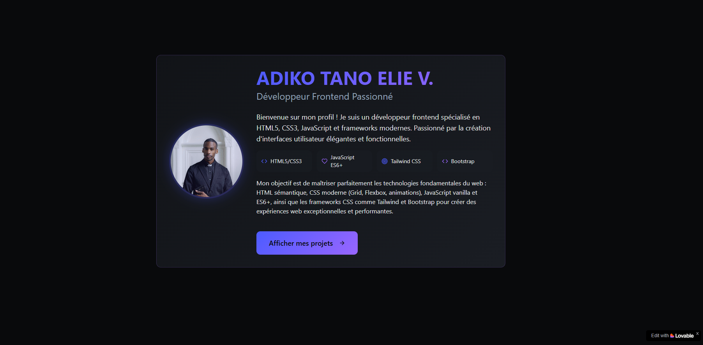

# Page de présentation — expérimentation de vibe coding

Page de présentation personnelle (« ADIKO TANO ELIE V. – Développeur Frontend ») générée avec l'outil de développement assisté par IA [Lovable](https://lovable.dev), puis exportée en HTML.

## Aperçu

## Contenu de la page

- Nom, titre et texte de présentation
- Photo de profil
- Badges de compétences : HTML5/CSS3, JavaScript ES6+, Tailwind CSS, Bootstrap
- Bouton « Afficher mes projets »

## Ce que contient le dépôt

- `index.html` : rendu HTML exporté de la page (le code exporté indique des composants React/TypeScript et des classes Tailwind CSS).
- `CAPTURE.png` : capture d'écran du résultat.

Le code source du projet Lovable n'est pas inclus. `index.html` fait référence à des fichiers `/assets/index-*.js` et `/assets/index-*.css` absents du dépôt : ouvert localement, son rendu peut différer de la capture.

## Objectif

Expérimenter la génération d'interface par prompt (« vibe coding ») et la personnalisation du résultat.

## Lancer le projet

Ouvrir `index.html` dans un navigateur, ou consulter directement la capture ci-dessus.
